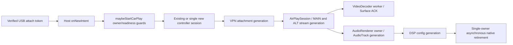

# STEP4 Ownership Map — Main Baseline

This map records current main before behavior changes. It supports race reviews and does not claim every lifecycle has already been stress-tested.

| Resource / state | Current owner | Handoff and close path | Review point |
|---|---|---|---|
| Wired startup attempt / NCM bridge | `CarPlayController` increments `wiredStartupAttempt`, opens iAP2 asynchronously, opens NCM, and transfers the connection into `NcmUsbBridge.open()` (`shared/.../orchestration/CarPlayController.kt`, `openDataPaths`, `openNcm`). | Stale generation callbacks close their returned session/bridge. Controller teardown closes its active NCM bridge and iAP2 session. | Keep attempt ID, data-path generation, and Activity restart generation distinct. |
| NCM USB connection / bulk-IN request / NTB queue | `NcmUsbBridge` owns the connection on successful open; one persistent `UsbRequest` and `requestWait` path own async bulk IN. `readLock`, `stateLock`, and `writeLock` protect separate state. | `close()` stops status polling, cancels a queued request, closes the connection to wake `requestWait`, waits for `recv()` to exit, then closes the request. | Do not requeue a timed-out request. Status polling uses `bulkTransfer`; it is not another `requestWait` owner. |
| NCM interface/endpoint selection | `NcmFunctionDiscovery` selects control/data interfaces and endpoints from configuration/raw CDC descriptors; `NcmUsbBridge.open()` claims interfaces and selects the data alternate setting. | On setup failure, the open path releases claimed interfaces and closes the connection. | Preserve same-interface alternate-setting semantics and record descriptor evidence. |
| TUN descriptor / IPv6 bridge workers | `CarPlayVpnService.attach()` establishes the TUN and creates `Ipv6NcmBridge`; the bridge starts `ncm-ipv6-in` and `ncm-ipv6-out` threads. | `Ipv6NcmBridge.close()` closes NCM and TUN, then joins both workers. `CarPlayVpnService.releaseLocked()` also closes its retained TUN reference after closing the bridge. | Both service and bridge close the same retained `ParcelFileDescriptor`; audit idempotence/single-owner cleanup before changing it. |
| Wired path diagnostics | `CarPlayController` creates one recorder for each `wiredStartupAttempt` only while `debug_logs_enabled` is on; NCM, TUN/VPN and AirPlay sessions share the reference. The recorder keeps fixed atomic counters and first timestamps; `attachGeneration` remains separate from the attempt ID. | Soft/hard/success/final snapshots go to the existing bounded trace writer. Final seal rejects late callbacks; stale generation callbacks increment only the stale counter. | Keep reports at milestone boundaries. Do not add packet logs, raw addresses, MACs, payload copies, or `ConnectionTraceEvent` schema fields. |
| VPN attachment / AirPlay listener / sessions | `CarPlayVpnService` owns `attachGeneration`, bridge, TUN reference, server socket and active `AirPlaySession` set. | `releaseLocked()` increments generation, closes listener, sessions, bridge and TUN; callbacks check attachment generation. | Separate TCP accept, RTSP active, MAIN setup and first frame evidence. |
| Activity timers / UI owner | `CarPlayHostActivity` owns main-thread display/reconnect handlers. `CarPlayBackgroundSession` transfers controller/sink ownership while no Activity is visible. | Activity removes callbacks on destruction; process-local handoff retains or clears the snapshot using owner checks. | `restartAfterReconnectDelay` currently checks `restartGeneration`; EX-02 tests must model recovery/loss epochs before changing it. |
| Host layout / local viewport | `CarPlayHostActivity` owns the mutually exclusive Full/YouTube/DSP mode, the three sibling panes, and the pending split/local viewport request. `DisplaySize` cause distinguishes a local pane layout from a physical display change. | A local fit updates only the fitted CarPlay content frame. A pending split is shown only after the current owner, Controller, remote size, and Surface make local fitting safe; no local cause enters the display restart coordinator. Before any session exists, normal startup sizes from the full host viewport. | Keep `activeDisplaySize` remote and `localViewportSize` local. The CarPlay TextureView and touch overlay stay together under the same fitted frame. |
| SurfaceTexture / Surface generation | `CarPlayHostActivity` tracks the current generation and ACK-gated retired `Surface` objects by identity. `AndroidMediaSink` and each `VideoDecoder` own per-screen detach ACKs. | At most eight active/retiring Surface pairs are admitted; when all slots are occupied, only the newest `SurfaceTexture` is deferred. MAIN and ALT ACKs must both complete before the retired `Surface` is released; the Texture is released only when its destroyed generation has no remaining Surface owners. | Keep queued retirement callbacks after detach/close failures. Same-Texture Surface replacement waits for decoder ACK without releasing the still-live Texture. |
| YouTube Gecko sessions | `YoutubeBrowserController` owns primary/popup `GeckoSession`s, profile context, lifecycle and view. | Same-context suspended primary session may be reactivated; identity change or destroyed lifecycle closes the session. | Preserve Google context isolation, popup state, and visible-paint timing through Split changes. |
| DSP editor draft / Compose UI | The application `DspProfileRuntime` owns one `DspEditorSession`; the full-screen Activity and Host `ComposeView` share its draft, applied profile, master state, and async operation generation. | Hiding a pane leaves its ComposeView attached and its draft in the runtime session. Host/Activity saved state carries a validated draft for process recreation; process death does not imply a live CarPlay connection. | Profile edits remain drafts until Apply/Save. Master ON/OFF retains its existing immediate async behavior; older import/apply/save callbacks cannot replace a newer operation. |
| Media/audio/video sink | `AndroidMediaSink` owns each `AudioRenderer`/decoder and AudioTrack/surface interaction; `CarPlayMediaEngine` assigns audio-owner tokens per stream. | Stream stop/format change releases or replaces renderer/decoder state; session teardown closes media resources. | Keep MEDIA distinct from NAV/telephony/microphone routes and preserve audio clock ownership. |
| DSP profile / runtime snapshot | `DspProfileRuntime` owns profile persistence, impulse repository, IO executor and master-enable preference. `AudioRenderer` owns the active pipeline; `DspLiveUpdateController` prepares candidates, and a dedicated reaper closes retired pipelines. | Runtime config is snapshotted per renderer; PEQ plus active Cabin Correction is capped at 15 before apply/save/load can publish; candidate preparation and old-graph retirement are separate. Render-thread retirement only publishes the existing pipeline through an intrusive lock-free handoff; adoption waits for asynchronous close completion. | Keep common transport latency separate from Seat Focus interchannel delay; the bypass preserves both the common delay and the accepted graph's near-channel timing. |
| Connection trace storage | `ConnectionTraceStore` is app-owned; callbacks enqueue bounded records to one writer executor. | Snapshot reads on that executor; capture is opt-in through `debug_logs_enabled` (default false). | Keep payloads and raw identifiers out of logs. |

`NcmUsbBridge.drainFrames()` is the current RX framing boundary. It consumes the optional one-byte short-packet pad only when present. For an incomplete but structurally plausible NTH16 length, bounded recovery skips only past the validated NDP/datagram extent to a complete next block with the expected sequence; device endpoint behavior remains `NOT_RUN`.

## PR #45 review-fix ownership and callback fences

The rows below describe the existing owner checks and the changes made by the 2026-10-27 review-fix batch. They do not claim target-device acceptance.

| Subsystem | State owner and generation | Final callback / timer check | Failure behavior |
|---|---|---|---|
| USB attach and wired startup | Exported `CarPlayUsbAttachActivity` verifies permission, currently attached identity, and CH341 VID/PID before creating a single-use internal action. `CarPlayHostActivity` consumes and sanitizes that token. The subsequent controller attempt owns its existing wired startup/data-path generations. | Wired attach clears reconnect suppression and calls `maybeStartCarPlay()`. That method rechecks shutdown/finish state, restart suppression and handoff, `CarPlayBackgroundSession` owner, display size, VPN readiness, location/microphone readiness, menu/handshake state, and `controller`. Wireless and wired attach requests observed during a non-process shutdown are coalesced to one completion after teardown. | Invalid/external/replayed actions cannot reach the wired resume path. Readiness gaps use existing VPN/display callbacks; no attach retry timer is added. An existing controller or background owner is reused. Process-exit shutdown explicitly blocks deferred restart. |
| iPhone USB auto-launch request | `IphoneUsbAutoLaunchCoordinator` owns attach deduplication generations. `IphoneUsbAutoLaunchRequestQueue` owns one latest deferred/handoff request and its host-layout snapshot. | New attach events use the duplicate window; queued replay carries an internal replay marker, revalidates current device/setting, and bypasses attach debounce. Explicit SETTINGS/FOREGROUND retries also bypass it. Handoff completion/failure is scoped by generation and only runs after confirmed Controller teardown. | Stale requests are rejected. If no fresh attach event can identify the same phone after USB re-enumeration, auto-launch remains fail-closed; never infer identity from VID/PID alone. |
| VPN attachment and AirPlay sessions | `CarPlayVpnService` owns `attachGeneration`, listener, TUN/bridge, and active sessions. `CarPlayController` owns the wired startup attempt and data-path generation. `CarPlayMediaEngine` owns current MAIN/ALT stream identities. | Accept, revoke, and listener callbacks compare the captured attachment generation and listener/attachment identity. Media callbacks compare `screenStreamOwners[type]` and the current `streams[streamKey]` before acting. | Stale attachment/session callbacks cannot detach or publish into their replacement. Existing bounded TCP/session limits and teardown order remain unchanged. |
| Host Activity and background session | `CarPlayHostActivity` owns `restartGeneration` and `connectionEpoch`; `CarPlayBackgroundSession` transfers `ownerEpoch` and the controller/sink snapshot, and tracks pending teardown tokens. | `restartAfterReconnectDelay` validates all three values through `ReconnectAfterLossGate`. Controller listeners validate restart generation, connection epoch, and current Activity owner before UI changes or teardown. Shutdown/restart callbacks receive `CLOSED`, `TIMED_OUT`, or `FAILED`; host startup callbacks run only after the controller close is confirmed and the teardown token is cleared. | Timeouts keep `hasSession()` true, retry off the main thread, and block replacement Controller creation. Deferred USB requests resume after close; a handoff with a stale/destroyed owner returns the latest request to the deferred queue. A stale timer/listener returns without stopping or replacing the current controller. |
| MAIN/ALT decoder and Surface | `AndroidMediaSink` owns per-type `videoStreamGenerations`, decoder identity, retiring decoder references, and the bounded `VideoPendingOutputState` wake-up estimate. `VideoDecoder` owns codec operations on its worker. `CarPlayHostActivity` / `SurfaceRetirementGate` retain SurfaceTexture generations until every decoder ACK arrives. | Recovery/keyframe callbacks check current stream generation and handler generation. First-frame callbacks check current generation and decoder identity. Decoder replacement requires both `isStopped()` and `surfaceReleaseSafe`. Recent input/output activity holds a 50 ms drain grace when the approximate pending-output count reaches zero; diagnostics name PTS-correlated `receivedToCodecSurfaceReleaseMs` and report unmatched/overwritten correlations. | Codec release gets at most two same-worker attempts per codec. Persistent failure retains decoder/Surface ownership, refuses replacement, and reports `SESSION_RESTART_REQUIRED`; no fake ACK or forced Surface release occurs. Surface-retirement backpressure remains capped at eight generations. The latency percentile ends after the Surface release call returns, not display presentation. |
| AudioRenderer and DSP graph | `AndroidMediaSink` owns each renderer under an `AudioOwnerToken`. `AudioRenderer` owns its AudioTrack generation, DSP configuration generation, active graph, and one renderer epoch. `DspLiveUpdateController` prepares candidates; `DspPipelineReaper` owns detached native destruction. | Prepared candidates validate renderer/controller epoch, format, requested config generation, and `rendererReleased` at the synchronized publication/adoption points. DSP retirement failures are sticky for that renderer; an old renderer callback is ignored after release. | DSP OFF remains legacy PCM16 and zero added latency. Detached old graphs and pending candidates go to the reaper; close failures keep updates blocked until a new renderer reports its own active status. No old native handle is reused or cleared as successful. |

## Review-fix sequence

